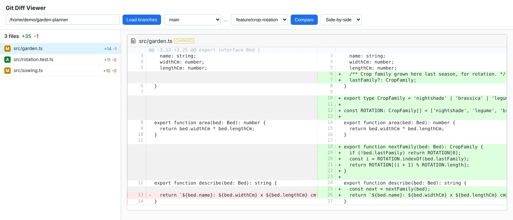
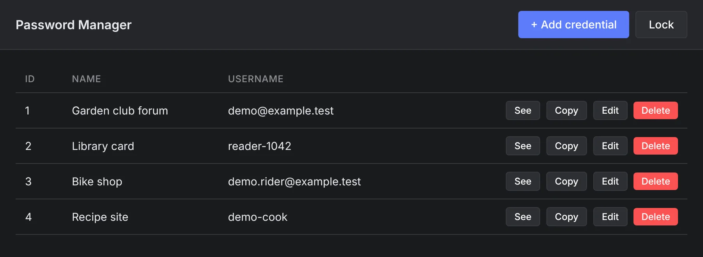
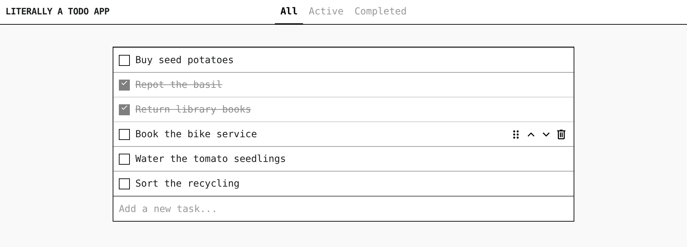

# mini-projects

Five small projects from December 2025 to May 2026, kept in one repo with their commit histories: a diff viewer for local git repos, a desktop password manager, a todo app, a TSP solver and a tomato detector.

<p align="center">
  
</p>

**Status:** Finished small projects, kept for reference. None is deployed and none is in active development. Each one runs on your own machine. The original repositories are no longer public; this repo keeps their history.

## What is in it

| Folder | What it is | Built with | Built |
|---|---|---|---|
| [git-helper-ui/](git-helper-ui/) | A GitLab-style diff viewer for any git repo on your disk. Pick two branches and read the diff file by file. | React, Vite, Express, simple-git | May 2026 |
| [pw-manager/](pw-manager/) | A desktop password manager. One master password unlocks a local vault that locks itself after 10 idle minutes. | Electron, SQLite, AES-256-GCM | May 2026 |
| [literally-a-todo-app/](literally-a-todo-app/) | A todo list with filters, drag to reorder and a stark monospace look. | React, Fastify, SQLite | April 2026 |
| [fai-project-tsp-astar-mst/](fai-project-tsp-astar-mst/) | A travelling salesman solver: A* search, with the cost of a minimum spanning tree as the heuristic. | Python | January 2026 |
| [tomato-detection-computer-vision/](tomato-detection-computer-vision/) | Finds ripe tomatoes in a photo with an HSV colour mask, cleanup and contour filters, from the command line or a Tkinter window. | Python, OpenCV | December 2025 |

## Screenshots

<table>
<tr>
<td width="50%" valign="top"></td>
<td width="50%" valign="top"></td>
</tr>
</table>

The TSP solver prints its tour as text. On the small test graph that ships with it:

```text
$ python main.py
1 5 4 2 3 1 16
```

That is the cycle 1 → 5 → 4 → 2 → 3 → 1 and its total weight, 16.

## Run one

Each folder stands on its own; there is no install at the root. The two web apps need Node 20 or newer, the password manager needs a desktop session, and the Python projects need Python 3. From the repo root, one at a time:

```bash
cd git-helper-ui && npm install && npm run dev        # http://localhost:5173
cd pw-manager && npm install && npm run rebuild && npm start
cd fai-project-tsp-astar-mst && python main.py
```

The todo app and the tomato detector take two steps each. All five, with ports and inputs: [docs/getting-started.md](docs/getting-started.md).

## How the repo was made

Each project was its own repository first. In July 2026 they were merged here with `git subtree`, one folder each, so `git log` still shows every original commit.

## Docs

- [docs/](docs/README.md): setup for every project and how the images were made
- Each folder's own README, for example [git-helper-ui/README.md](git-helper-ui/README.md) with its API and the Docker setup
- Project wiki: [corpus/](corpus/index.md)

## License

The TSP solver and the todo app carry their own MIT license files. The other three have none, so all rights are reserved for them.
