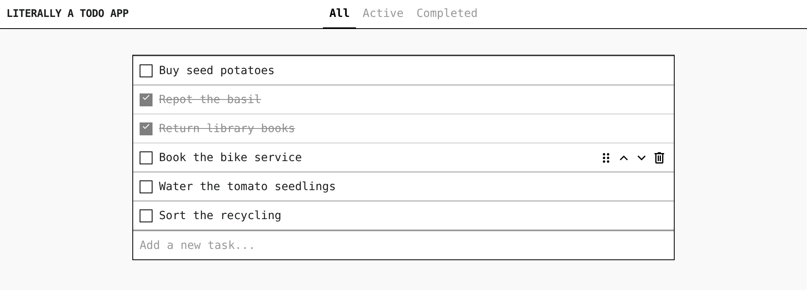

# literally-a-todo-app

A todo list, and nothing more: add tasks, tick them off, filter by All, Active and Completed, and reorder them by dragging or with the arrow buttons.

<p align="center">
  
</p>

A React page talks to a small Fastify API that keeps the list in SQLite.

## Run it

```bash
cd backend && npm install && npm run dev      # the API on 127.0.0.1:3000
cd frontend && npm install && npm run dev     # http://localhost:5173
```

Run them in two terminals. The list is stored in `todos.db` in this folder. The API, the stack and the design rules are in the project's wiki, [docs/wiki/](docs/wiki/index.md).

## License

MIT, see [LICENSE](LICENSE).
