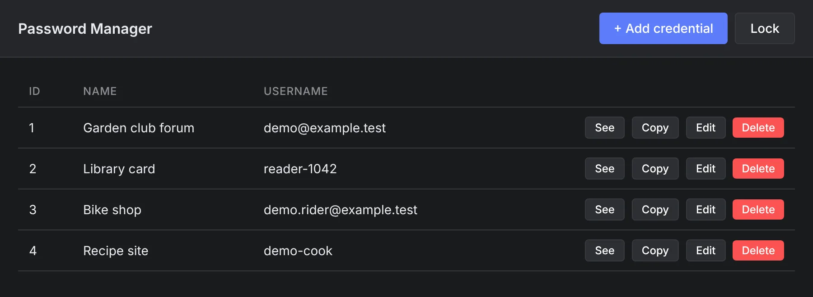

# pw-manager

A desktop password manager for one person. A master password unlocks a local vault of logins, and the vault locks itself again after 10 idle minutes.

<p align="center">
  
</p>

The vault is a SQLite file. Each password is encrypted with AES-256-GCM under a key derived from the master password with PBKDF2, and that key stays in Electron's main process; the window reaches it only through a narrow preload bridge. The master password cannot be recovered.

## Run it

```bash
npm install
npm run rebuild      # builds better-sqlite3 for Electron's Node
npm start            # builds, then opens the window
```

The vault lives at `~/.config/pw-manager/vault.db` on Linux. How the code is split between the main process, the preload bridge and the window: [CLAUDE.md](CLAUDE.md).
